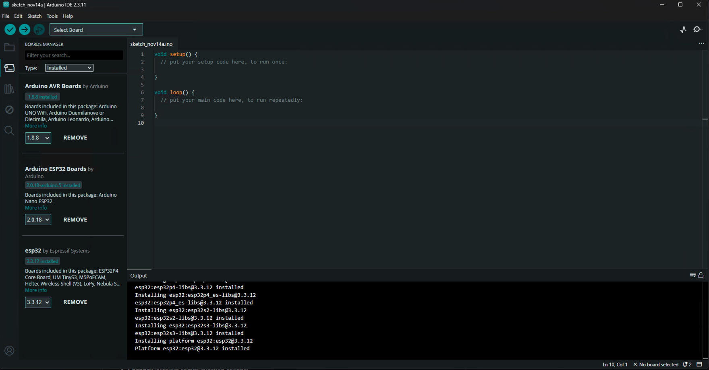
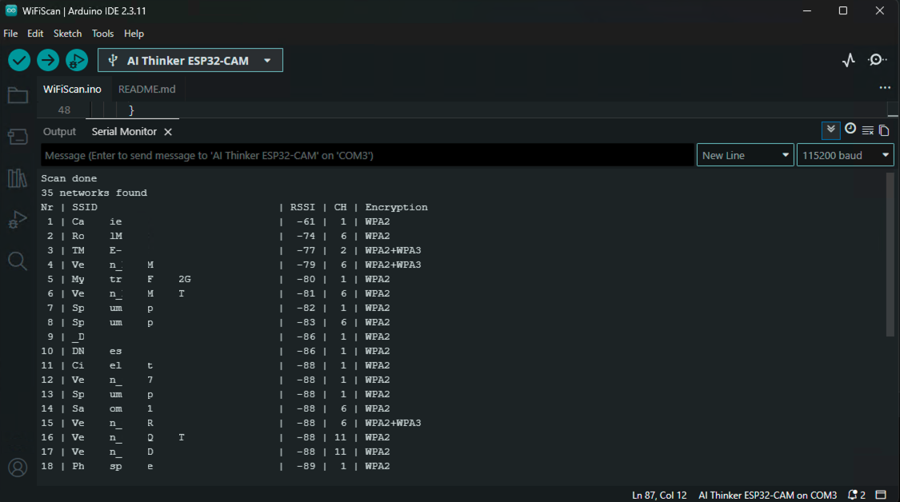

# ESP32-CAM Wi-Fi Scanner

**Academic Program:** A.A.S. in Cybersecurity — Bronx Community College  
**Project Type:** Hardware & Wireless Networking Lab  
**Status:** Completed — November 14, 2026

## 1. Project Overview

This project demonstrates the configuration and implementation of an ESP32-CAM microcontroller using the Arduino IDE in a Windows lab environment.

The primary objective was to execute a Wi-Fi scanning sketch capable of discovering nearby wireless networks and displaying information such as SSIDs, signal strength (RSSI), wireless channels, and encryption protocols.

The project also emphasizes hardware configuration, troubleshooting, and technical documentation through GitHub.

## 2. Project Objectives

- [x] Fork and customize the original GitHub documentation template.
- [x] Install and configure the Arduino IDE.
- [x] Install ESP32 board support by Espressif Systems.
- [x] Establish USB-to-serial communication with the ESP32-CAM.
- [x] Compile and upload the WiFiScan sketch.
- [x] Execute wireless network discovery.
- [x] Analyze network information through Serial Monitor.
- [x] Modify the sketch to prevent continuous scanning.
- [x] Document the configuration, testing, and results.

## 3. Equipment and Software

| Component | Description |
|---|---|
| Development Board | ESP32-CAM |
| Board Profile | AI Thinker ESP32-CAM |
| USB Interface | CH340 USB-to-Serial |
| Communication Port | COM3 |
| Operating System | Windows |
| Development Environment | Arduino IDE 2.3.11 |
| Board Package | esp32 by Espressif Systems 3.3.12 |
| Serial Monitor | 115200 baud |
| Example Sketch | WiFiScan |

## 4. Setup and Implementation

### Step 1 — GitHub Repository Setup

Forked the original course documentation template and customized the repository to document the ESP32-CAM Wi-Fi scanner project.

### Step 2 — Arduino IDE Installation

Installed and launched Arduino IDE 2.3.11 in the Windows lab environment.

Verified that the application and its development tools were functioning.

### Step 3 — ESP32 Board Configuration

Configured the Arduino IDE Boards Manager using the official Espressif package URL:

`https://espressif.github.io/arduino-esp32/package_esp32_index.json`

Installed **esp32 by Espressif Systems**, version **3.3.12**.

The installation was confirmed through the Boards Manager and Arduino IDE output console.

**Installation Evidence:**

*Figure 1. Arduino IDE with the Espressif ESP32 board package successfully installed.*

### Step 4 — Hardware Communication

Connected the ESP32-CAM through its USB-to-serial programming interface.

Windows Device Manager detected the interface as:

**USB-SERIAL CH340 (COM3)**

Configured Arduino IDE with the AI Thinker ESP32-CAM board profile and selected COM3 for serial communication.

### Step 5 — Wi-Fi Scanner Compilation and Upload

Opened the WiFiScan example through:

**File → Examples → WiFi → WiFiScan**

The sketch compiled successfully using the installed Espressif ESP32 development package.

Compilation results:

| Resource | Used | Maximum | Utilization |
|---|---:|---:|---:|
| Program Storage | 890,528 bytes | 3,145,728 bytes | 28% |
| Global Variables | 45,736 bytes | 327,680 bytes | 13% |

The sketch was uploaded to the physical ESP32-CAM.

The upload process completed, and Arduino reported the device reset operation.

## 5. Wi-Fi Scanner Results

After uploading the sketch, the ESP32-CAM successfully scanned nearby wireless networks.

The results were displayed in Arduino Serial Monitor using a baud rate of **115200**.

The scanning output provided the following information:

- **SSID:** Advertised wireless network name.
- **RSSI:** Received signal strength measured in dBm.
- **Channel:** Wireless channel used by the access point.
- **Encryption:** Security protocol advertised by the network.

The recorded scan included networks using WPA2, WPA3, and mixed WPA2/WPA3 security modes.

Detected wireless channels included channels 1, 6, and 11.

**Wi-Fi Scanning Evidence:**

*Figure 2. ESP32-CAM successfully detecting nearby wireless access points through Arduino Serial Monitor. Network names are concealed for privacy.*

### Understanding RSSI

RSSI describes the strength of the wireless signal received by the ESP32.

For example:

- **-50 dBm:** Strong signal.
- **-70 dBm:** Moderate signal.
- **-90 dBm:** Very weak signal.

RSSI values closer to zero generally indicate stronger received signals.

The scanner identifies advertised network information without requiring authentication or establishing a connection to those networks.

## 6. Troubleshooting and Adjustments

### Issue 1 — Continuous Wi-Fi Scanning

**Observation:** The WiFiScan sketch continuously repeated its scanning process.

**Cause:** Arduino repeatedly executes instructions contained within the `loop()` function.

**Solution:** Added a continuous idle loop at the end of the existing `loop()` function to prevent additional scans.

The modification allows the device to perform its scanning cycle and then remain idle until restarted.

**Result:** Repeated scanning was successfully stopped.

### Issue 2 — Missing Serial Monitor Output

**Observation:** After modifying the sketch, the Serial Monitor initially displayed no scanning results.

**Cause:** The modified program performed a single scanning cycle, meaning the results could be missed if Serial Monitor opened after execution.

**Solution:** Restarted the ESP32-CAM while monitoring its serial output.

**Result:** Scanning information was successfully displayed.

## 7. Results and Conclusion

**Final Result: Successful**

The ESP32-CAM was configured, programmed, and tested successfully using Arduino IDE in a Windows environment.

The device demonstrated the ability to discover nearby Wi-Fi access points and report their wireless characteristics through serial communication.

This laboratory exercise provided practical experience with:

- Embedded hardware configuration.
- Arduino IDE and ESP32 development tools.
- USB-to-serial communication.
- Firmware compilation and uploading.
- Wireless network discovery.
- Serial Monitor troubleshooting.
- Technical project documentation.

The project also reinforced the importance of understanding program execution, particularly the difference between Arduino's `setup()` and `loop()` functions.

## 8. References

- [Original Documentation Template](https://github.com/ereedsanchez/CSN150-Doc-Template)
- [Arduino Official Website](https://www.arduino.cc/)
